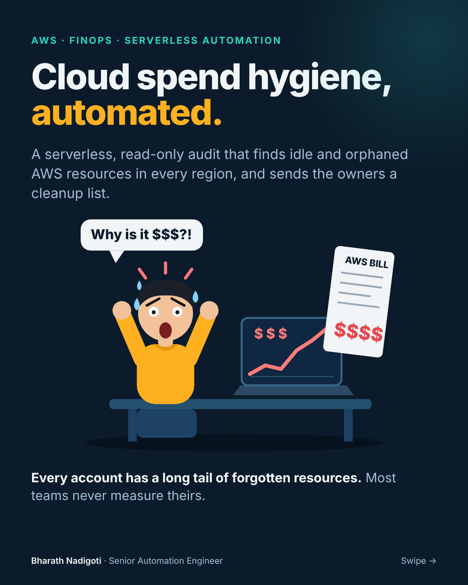
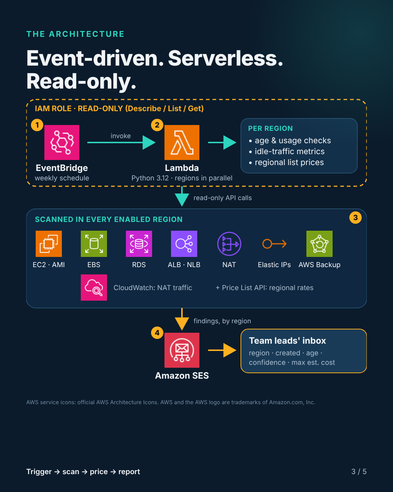
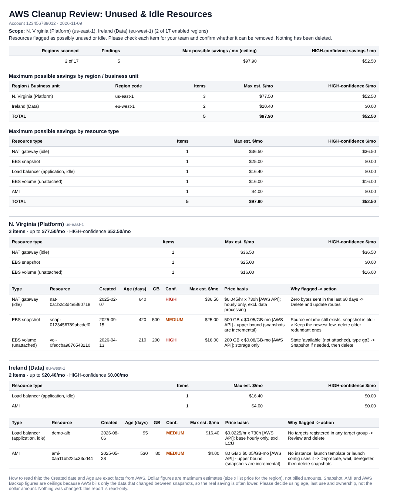

# AWS Cloud Spend Hygiene

A serverless, **read-only** audit that finds idle and orphaned AWS resources in every region (or the ones you choose) and emails a cleanup list, grouped by region, to the people who own them.



Projects end and teams move on, but the resources keep billing. This tool makes that long tail visible every week. **It never deletes or modifies anything.** Cleanup is a separate decision made by humans.

## Architecture



EventBridge (weekly schedule) → Lambda (Python 3.12, scans regions in parallel) → read-only API calls per region → Amazon SES → team leads' inbox.

## What it checks

| Resource | Flagged when |
|---|---|
| EBS snapshots | Older than `MIN_AGE_DAYS` and not backing an AMI (HIGH if the source volume is gone) |
| AMIs | Older than `MIN_AGE_DAYS`, no instance, launch template or launch configuration uses it, not launched recently |
| EBS volumes | State `available` (unattached) |
| EC2 instances | Stopped longer than `STOPPED_DAYS` (their volumes still bill) |
| Elastic IPs | Allocated but not associated |
| NAT gateways | Zero bytes out in the last `IDLE_LOOKBACK_DAYS` (CloudWatch `BytesOutToDestination`) |
| Load balancers (ALB/NLB) | No registered targets in any target group |
| RDS / Aurora | Manual snapshots and cluster snapshots older than `MIN_AGE_DAYS` |
| AWS Backup | Completed recovery points with no expiry, older than `MIN_AGE_DAYS` |

Anything tagged `keep=true` (configurable) is never reported.

## The report



Each row shows the **created date and age** (exact facts from AWS), a **confidence** level (HIGH = orphaned, MEDIUM = the owner should confirm), the **evidence** and a suggested action.

### How to read the dollar figures
Costs are **maximum estimates**, not your bill: resource size × the regional list price from the AWS Price List API, shown in the "Price basis" column. Snapshot, AMI and AWS Backup figures are **ceilings** because AWS bills only the data that changed between snapshots. Decide using age, last use and ownership, not the dollar amount. If you want billed amounts, the optional CUR feature below replaces estimates with real figures.

## Quick start (about 15 minutes)

1. **IAM role.** Create a Lambda execution role with `AWSLambdaBasicExecutionRole` plus the inline policy in [`iam/policy.json`](iam/policy.json) (describe/list/get calls and `ses:SendEmail` only).
2. **Lambda.** Create a function: Python 3.12, handler `lambda_function.lambda_handler`, timeout 15 min, memory 512 MB. Paste [`src/lambda_function.py`](src/lambda_function.py) and deploy.
3. **SES.** Verify the sender (and recipients while SES is in sandbox).
4. **Environment variables.** At minimum `SES_FROM` and `SES_TO` (see the table below).
5. **Test, then schedule.** Run a test event `{}`. Then add an EventBridge schedule, for example `cron(0 12 ? * MON *)`.

Prefer infrastructure as code? Use [`template.yaml`](template.yaml):

```bash
aws cloudformation package --template-file template.yaml \
    --s3-bucket <your-artifact-bucket> --output-template-file packaged.yaml
aws cloudformation deploy --template-file packaged.yaml --stack-name cloud-spend-hygiene \
    --capabilities CAPABILITY_IAM \
    --parameter-overrides SesFrom=you@example.com SesTo=team@example.com
```

### Choose regions per run
- Default: all enabled regions.
- Variable: `REGIONS=us-east-1,ca-central-1` (or `all`).
- Per schedule: use a constant JSON input such as `{"regions": ["us-east-1"]}`. The event wins over the variable.

### Check your prices
Invoke with `{"price_check": true, "regions": ["us-east-1"]}` and open the CloudWatch log. Every rate shows where it came from: `[AWS API]`, `[your override]` or `[approx (us-east-1)]`. If you see `approx`, check that the role allows `pricing:GetProducts`.

## Configuration

| Variable | Default | Purpose |
|---|---|---|
| `SES_FROM`, `SES_TO` | none | Verified sender and comma-separated recipients (HTML email via SES) |
| `SES_REGION` | Lambda's region | Region used for SES |
| `SNS_TOPIC_ARN` | none | Plain-text fallback when SES isn't configured |
| `REGIONS` | all | `all` or a comma-separated list of region codes |
| `REGION_LABELS_JSON` | none | Team labels per region, e.g. `{"us-east-1": "N. Virginia (Platform)"}` |
| `REPORT_TITLE` | AWS Cleanup Review: Unused & Idle Resources | Email heading |
| `MIN_AGE_DAYS` | 90 | Minimum age for snapshots, AMIs and backups |
| `STOPPED_DAYS` | 30 | Minimum time stopped for EC2 instances |
| `IDLE_LOOKBACK_DAYS` | 14 | NAT gateway idle window |
| `EXCLUDE_TAG_KEY`, `EXCLUDE_TAG_VALUE` | keep, true | Resources with this tag are never reported |
| `MAX_ROWS` | 0 (all) | Limit rows listed in the email (totals always include everything) |
| `REPORT_BUCKET` | none | Also write CSVs to this S3 bucket |
| `SHOW_SPEND` | false | Add a "last month's related charges" section (needs `ce:GetCostAndUsage`) |
| `USE_PRICING_API` | true | Look up regional prices from the AWS Price List API |
| `PRICES_JSON`, `REGION_PRICES_JSON` | none | Override rates, e.g. `{"snapshot_gb": 0.055}` |
| `SIGNATURE_NAME` and others | none | Optional email signature (`SIGNATURE_TITLE`, `_COMPANY`, `_PHONE`, `_EMAIL`, `_NOTE`, `_OOO`, `_LOGO_URL`) |

### Optional: billed amounts from your Cost and Usage Report
If you have a CUR table in Athena, set `CUR_DATABASE`, `CUR_TABLE` and `ATHENA_OUTPUT` (plus `CUR_PARTITION_SQL`, for example `AND year='{year}' AND month='{month}'`). For each flagged resource the report then shows last month's billed amount instead of an estimate. Resources with no CUR rows, or created during that month, keep the estimate and say so. Extra permissions are in [`iam/optional-extras.json`](iam/optional-extras.json). This feature assumes standard CUR column names.

## Security
- The role can only describe, list and get. It has no delete, terminate, modify or release permission.
- The email shows resource IDs and account ID. Send it only to people who should see them.
- No credentials or secrets are stored in the code or configuration.

## Known limitations
- Classic Load Balancers and Gateway Load Balancers aren't scanned.
- "Use by other accounts" of an AMI isn't checked.
- Estimates exclude data-processing and request charges, and io2 volume IOPS tier discounts.
- A redirect-only ALB with no targets will be flagged. The evidence column says to check.

## Develop
```bash
python3 tests/test_smoke.py   # offline, no AWS credentials needed
```

## License
MIT. See [LICENSE](LICENSE). AWS, Amazon EventBridge, AWS Lambda, Amazon SES and the AWS Architecture Icons are trademarks of Amazon.com, Inc. or its affiliates. This project is not affiliated with or endorsed by AWS.
